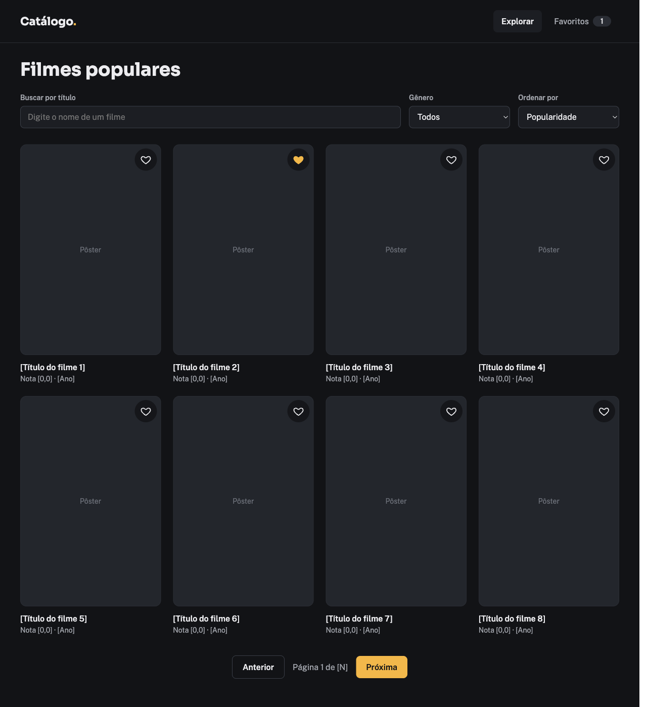

# Catálogo de Filmes



## 💬 Descrição

O Catálogo de Filmes é uma aplicação web para descobrir filmes populares, encontrar títulos por busca e gênero, ordenar resultados e consultar detalhes como sinopse, nota, elenco e trailers. Também permite salvar filmes favoritos para acessá-los novamente.

## ✨ Funcionalidades

- [x] Listagem da primeira página de filmes populares do TMDB;
  - [ ] Paginação de resultados;
  - [ ] Busca por título;
  - [ ] Filtro por gênero;
  - [ ] Ordenação por popularidade, nota e data de lançamento;
- [x] Página de detalhe em `/movie/[id]` com dados do TMDB, sinopse, elenco principal e trailer quando disponível;
- [ ] Favoritos com persistência no client e uma página ou aba que liste os favoritos.

## 🌐 Ambientes

### Local

O servidor de desenvolvimento fica disponível em [localhost:3000](http://localhost:3000) após iniciar a aplicação.

### Produção

Aplicação: [teste-tecnico-upflow.vercel.app](https://teste-tecnico-upflow.vercel.app/).

## 🚀 Começando

### Pré-requisitos

- [Node.js](https://nodejs.org/);
- npm, incluído na instalação do Node.js.

### Instalação e execução

Clone o repositório e entre na pasta do projeto:

```bash
git clone https://github.com/zehguilherme/teste-tecnico-upflow.git
cd teste-tecnico-upflow
```

Instale as dependências:

```bash
npm install
```

Configure o **API Read Access Token** do TMDB na variável `TMDB_ACCESS_TOKEN` do arquivo `.env` antes de iniciar a aplicação. Use o `.env.example` como referência e mantenha o valor real do token apenas no `.env`, que não deve ser enviado ao Git.

Inicie o servidor de desenvolvimento:

```bash
npm run dev
```

O token é usado somente pelo servidor e não deve receber o prefixo `NEXT_PUBLIC_`. Na hospedagem, cadastre a mesma variável nas configurações de ambiente do projeto.

Abra [http://localhost:3000](http://localhost:3000) no navegador.

## 🚀 Tecnologias

- [Next.js 16](https://nextjs.org/) e [React 19](https://react.dev/) — aplicação web e componentes;
- [TypeScript](https://www.typescriptlang.org/) — tipagem estática;
- [Node.js](https://nodejs.org/) e [npm](https://www.npmjs.com/) — ambiente de execução e gerenciamento de dependências e scripts;
- [Tailwind CSS 4](https://tailwindcss.com/) — estilos;
- [Turbopack](https://nextjs.org/docs/app/api-reference/turbopack) — empacotamento da aplicação e integração com o Tailwind CSS;
- [Jest 30](https://jestjs.io/) — testes automatizados, integrado ao Next.js com `next/jest`;
- [ESLint 9](https://eslint.org/) — análise estática do código;
- [Prettier](https://prettier.io/) — formatação dos arquivos compatíveis;
- [API do TMDB](https://developer.themoviedb.org/) — dados e imagens dos filmes;
- [Vercel](https://vercel.com/) — hospedagem da aplicação em produção.

## 🏗️ Arquitetura

A aplicação usa Next.js com App Router. A página inicial está em `app/page.tsx`, a consulta ao TMDB está em `lib/tmdb.ts`, o layout global e os metadados estão em `app/layout.tsx`, e o cabeçalho compartilhado está em `components/Header.tsx`. Ainda não há backend próprio nem persistência de dados.

## 🧭 Decisões técnicas e trade-offs

- **Next.js com App Router e TypeScript:** tecnologias definidas pelo enunciado, usadas como base da aplicação;
- **Tailwind CSS:** usado para aplicar estilos diretamente nos componentes e manter cores, espaçamentos e comportamento responsivo consistentes. Isso reduz a necessidade de folhas de estilo separadas, embora possa deixar os componentes com classes extensas;
- **Elementos nativos de formulário:** busca e filtros usam input e select do HTML, envolvidos por componentes React reutilizáveis. Isso aproveita semântica, acessibilidade e comportamento padrão do navegador; em contrapartida, a aparência dos controles pode variar entre navegadores;
- **API do TMDB:** a Home busca no servidor a primeira página de filmes populares em português brasileiro; a paginação continua pendente;
- **Pôsteres com `next/image`:** os cards usam imagens responsivas com otimização do Next.js, preservando a proporção de 2:3; os quatro primeiros pôsteres usam `loading="eager"` para não atrasar o LCP da primeira linha no desktop, e os demais usam `loading="lazy"`; a configuração permite imagens de `image.tmdb.org/t/p/w500/`;
- **Persistência de favoritos:** é um requisito funcional, mas ainda não está implementado no projeto atual.

## 🔌 API

O projeto consome a [API pública do TMDB](https://developer.themoviedb.org) com `fetch` nativo no servidor e a variável `TMDB_ACCESS_TOKEN`. A Home apresenta título, nota, ano e pôster dos filmes populares. A página `/movie/[id]` busca os detalhes, créditos, traduções e trailers do filme; usa o primeiro idioma disponível para a sinopse seguindo a prioridade português, inglês e idioma original. As imagens do TMDB são exibidas com `next/image`. Enquanto os dados carregam, as páginas usam o componente reutilizável `LoadingOverlay`; quando a API retorna um erro, exibem `ErrorModal` com a mensagem do TMDB ou uma mensagem segura em português. A paginação ainda não foi implementada.

## 🎨 Layout e design system

As imagens de referência para as telas de filmes populares, detalhe do filme e favoritos estão em [`design-references/stitch/`](./design-references/stitch/). A Home usa dados atuais do TMDB e mantém busca, filtros, favoritos e paginação sem comportamento funcional. Cada card aponta para `/movie/[id]`, que exibe os dados atuais do filme. O botão de favoritos da página de detalhe permanece desabilitado até a implementação desse recurso. As cores, tipografia e estilos globais estão definidos em `app/globals.css`; use os tokens de cor nas classes, sem valores literais nos componentes. Após alterações de interface, valide o código e a renderização em desktop e mobile com a skill [`stitch-design-validation`](./.agents/skills/stitch-design-validation/SKILL.md).

## ✅ Testes e validações

O workflow **CI** executa automaticamente em pushes para `develop` e `master` e em pull requests destinados a essas branches. Com Node.js 22, instala as dependências com `npm ci` e executa, em sequência, `npm run format:check`, `npm run lint` e `npm test -- --ci`. Qualquer falha reprova o check **Validações**. Os testes usam respostas controladas do TMDB; o workflow não precisa de token nem de secrets da API.

Para impedir merges quando as verificações falharem, configure a proteção da branch ou um ruleset no GitHub e marque **Validações** como check obrigatório. O workflow executa as verificações, mas essa regra de merge precisa ser configurada no repositório.

A aplicação carrega dados reais do TMDB. Nos testes com Jest, a resposta da API é substituída por respostas controladas para verificar a conversão dos filmes e o tratamento de erros, sem fazer chamadas ao TMDB. Execute-os com:

```bash
npm test
npm test -- lib/tmdb.test.ts
```

O lint e o build verificam automaticamente se os arquivos estão formatados. Para formatar todos os arquivos compatíveis ou conferir a formatação sem modificá-los, execute:

```bash
npm run format
npm run format:check
```

No VS Code, instale a extensão recomendada **Prettier - Code formatter** (`esbenp.prettier-vscode`). O workspace a configura como formatador padrão e aplica a formatação ao salvar.

## 📁 Estrutura do projeto

```text
app/                          # Página inicial, layout, estilos globais e favicon
components/                   # Componentes reutilizáveis, incluindo o cabeçalho
design-references/stitch/     # Referências visuais das telas
public/                       # Arquivos estáticos públicos
package.json                  # Dependências e scripts do projeto
```

## Acompanhamento

As alterações no projeto podem ser acompanhadas no [GitHub Projects](https://github.com/users/zehguilherme/projects/18).
